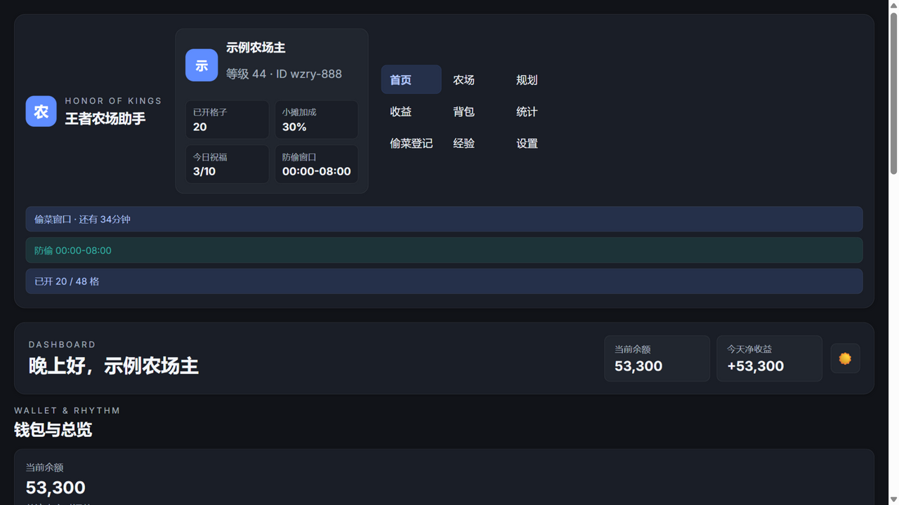
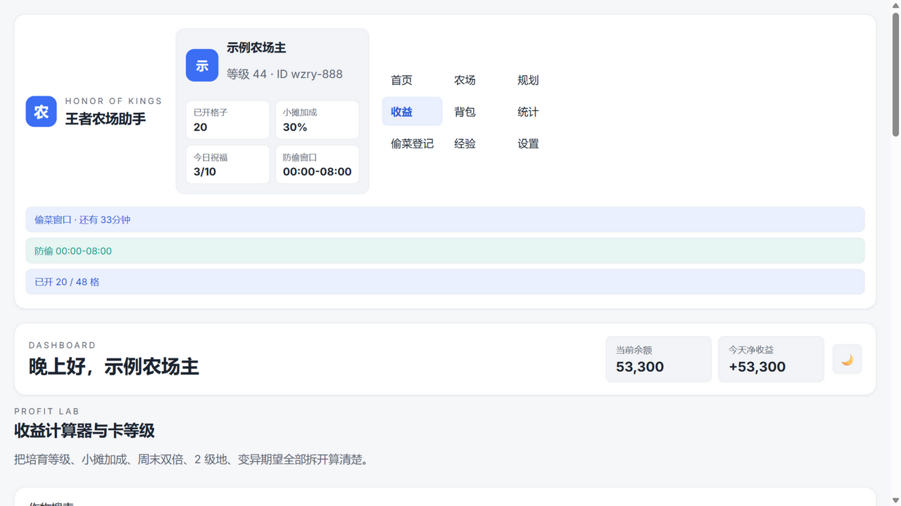
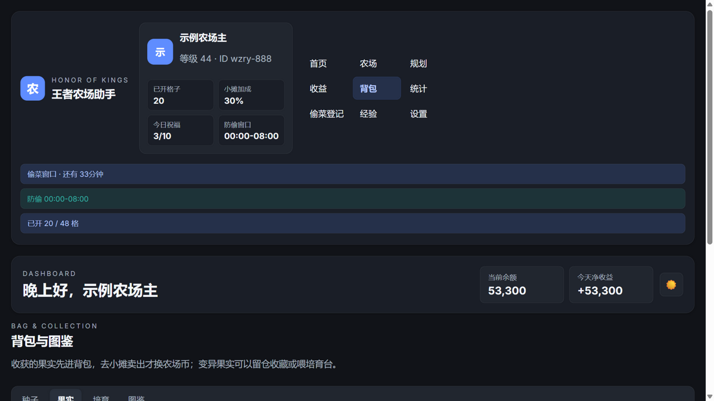
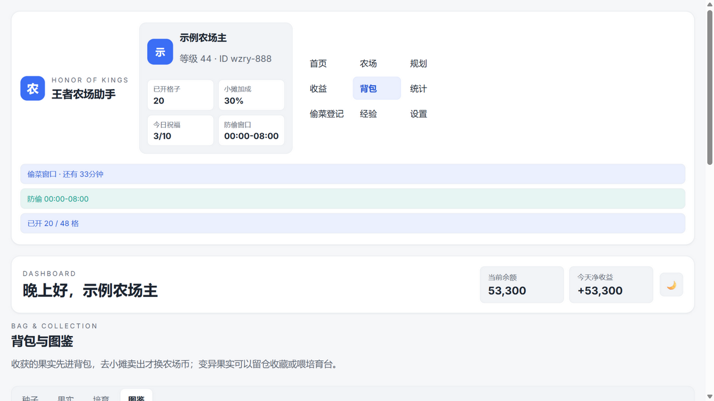
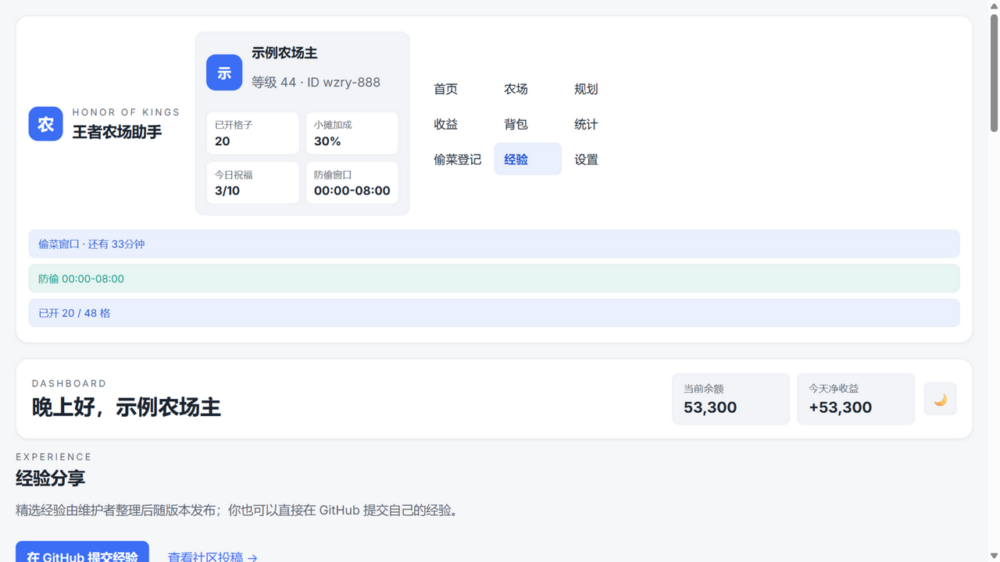
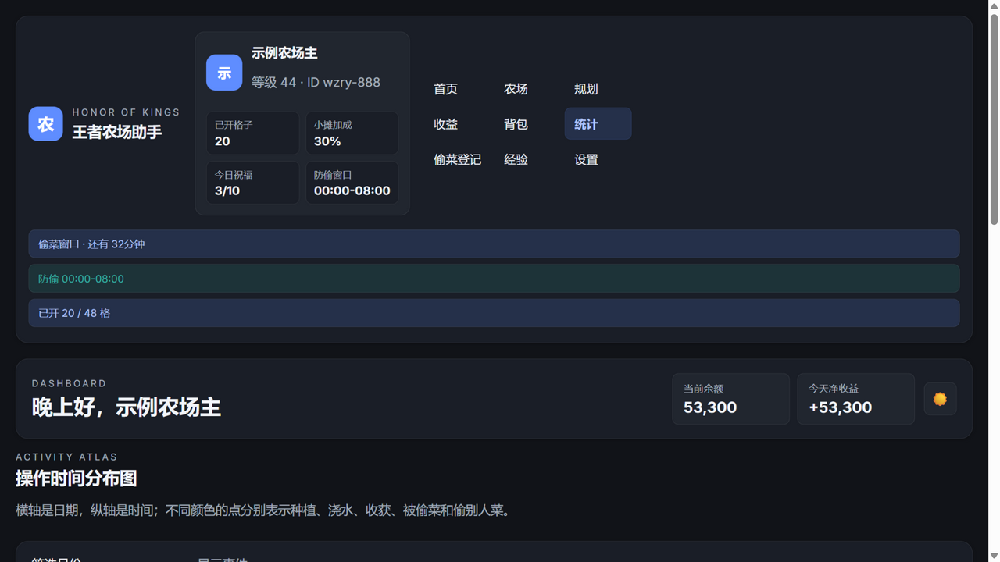

# 王者农场自动提醒

一个面向《王者荣耀》农场玩法的本地辅助工具，重点解决这些问题：

- 什么时候播种、浇水、收获
- 周末双倍怎么卡时间
- 防偷窗口怎么避开风险
- 种子、果实、变异词条怎么管
- 祝福次数和偷菜配额怎么安排
- 钱包余额和流水怎么自动记
- 偷别人菜、被别人偷菜怎么进账
- 多格子规划后，怎么继续手动改单格

当前版本已支持 `Windows` 本地运行，技术形态是：

- `Python 3.11`
- `SQLite`
- `JSON 规则与配置`
- `本地 Web UI（简洁亮色 + 暗黑双主题）`

## 界面展示

**首页总览（暗黑主题）**：钱包与背包估值、今日关键节点时刻表、祝福与偷菜配额一览。



**农场管理（简洁亮色）**：格子级状态色条、变异词条徽章与总倍率（×20 / ×70）、英雄防偷标记、祝福追踪面板。


**收益计算器（简洁亮色）**：培育 / 小摊 / 周末双倍 / 2 级地 / 变异期望逐步拆解，附作物对比表与卡等级建议。



**背包果实（暗黑主题）**：收获按批次入库，词条与倍率随批次记录，勾选卖出才入账。



**收获图鉴（简洁亮色）**：作物 × 变异组合收集进度网格。



**经验分享（简洁亮色）**：1680x 周流程清单 + 精选经验 + GitHub Issue 投稿入口。



**操作时间分布（暗黑主题）**：种植 / 浇水 / 收获 / 偷菜 / 祝福六色散点图。



## 部署流程

### 1. 推荐环境

推荐和当前开发环境尽量保持一致：

- `Python 3.11.0`
- `pip 25.0.1`
- `setuptools 75.8.2`
- `wheel 0.45.1`

说明：

- 当前项目运行时只依赖 Python 标准库。
- 也就是说，项目本身**没有额外第三方运行依赖**。
- 这里仍然建议把 `pip / setuptools / wheel` 统一好，方便后续打包和分发。

### 2. 安装 Python

推荐安装：

- `Python 3.11.0 x64`

安装后在终端验证：

```powershell
py -3.11 --version
```

或：

```powershell
python --version
```

### 3. 安装/统一包工具版本

在项目目录中执行：

```powershell
py -3.11 -m pip install --upgrade pip==25.0.1 setuptools==75.8.2 wheel==0.45.1
```

可选验证：

```powershell
py -3.11 -m pip --version
py -3.11 -m pip show setuptools
py -3.11 -m pip show wheel
```

### 4. 当前版本无需额外第三方运行包

也就是说，以下命令当前**不需要再额外执行任何业务依赖安装**：

```powershell
py -3.11 -m pip list
```

如果后续项目增加打包、邮件提醒、站点部署等能力，再补新的依赖列表。

### 5. 启动项目

方式 1：

```powershell
py -3.11 main.py
```

方式 2：

```powershell
run_app.bat
```

启动后会打开本地页面：

```text
http://127.0.0.1:8765/
```

### 6. 恢复默认数据

把所有配置、日志、钱包流水、规划状态恢复为默认空白：

```powershell
py -3.11 reset_to_defaults.py
```

或：

```powershell
reset_to_defaults.bat
```

这个脚本会做几件事：

- 尝试关闭本地服务
- 清空业务数据表
- 重建默认配置
- 保留规则文件

## 当前功能

### 1. 钱包与流水

已支持：

- 当前余额
- 今日收入
- 今日支出
- 今日净收益
- 最近流水列表

流水会记录：

- 买种子支出（种植时背包不足的缺口部分）
- 卖出果实收入（收获先进背包，卖出才入账）
- 偷别人菜收入
- 被偷菜损失

### 2. 规划系统

已支持：

- 选择作物并生成规划
- 现在立刻种的收益/风险判断
- 最早防偷方案
- 最优周末双倍方案
- 周末双倍 + 防偷叠加方案
- 一键把规划应用到已开格子

### 3. 农场编辑

已支持：

- 按格子解锁
- 2 x 2 地块布局
- 每块地 4 x 3 格
- 单格显示作物与剩余时间
- 单格变异词条徽章（蓝/紫/巨大化/超巨化/英雄角标 + 总倍率 + 祝福 n/3 + 英雄防偷标记）
- 编辑范围：
  - 全部已开格子
  - 某一整块地
  - 某一个格子
- 手动改单格/整块地/全部范围的：
  - 作物
  - 状态
  - 开始时间
  - 收获时间
  - 变异词条（服务端校验：普通 3 条上限、巨大化与超巨化互斥、8 级以下作物禁变异）
  - 备注
- 手动开始种植（优先消耗种子背包，缺口按种子价自动购买入账）
- 登记浇水（含"收获前 3 小时停水"提示）
- 登记收获（产出果实批次进背包，不再直接入账）
- 清空规划
- 祝福追踪面板（今日发出 10 次 / 被祝福 30 次进度条 + 快捷登记）

### 4. 浇水机制

当前版本已支持：

- 手动输入本次浇水减少的分钟数
- 更新收获时间
- 更新剩余时间
- 写入活动记录

当前设计思路：

- 允许用户"提前浇水"或"不按推荐时机浇水"
- 由用户明确输入本次扣掉的冷却时间
- 系统据此重算剩余时间和计划

### 5. 背包与图鉴

已支持：

- 种子背包：登记赛季奖励/购买/好友赠送的种子，种植时优先消耗
- 果实背包：收获按批次入库（含词条与倍率），勾选批量在小摊卖出才入账（单价 = 初始售价 × 培育倍率 × 小摊加成）
- 培育等级：每次收获 +10 培育值，进度条显示到下一级距离，满级 10 级售价 ×2
- 收获图鉴：作物 × 变异组合收集进度网格
- 周末双倍在收获时自动判定产量 ×2

### 6. 收益计算器与卡等级

已支持：

- 收益计算器：初始售价 → 培育倍率 → 小摊加成 → 周末双倍 → 2 级地(+50%) → 变异期望（自然变异率 20% × 平均词条倍率），逐步拆解
- 作物收益对比表（按当前农场等级过滤解锁，绿色高亮推荐行）
- 卡等级建议：按农场等级尾数推荐英雄作物（1/6）/ 经济作物（5/0）/ 联名种子（4/9）
- 开支顺序与变异优先级攻略卡片

### 7. 每日时刻表

已支持：

- 首页"今日关键节点"：05:00 每日重置、06:00/18:00 昼夜切换、08:00/24:00 偷菜窗口、周五 18:00 周末双倍开启、周日 24:00 结束
- 侧栏常驻"下一节点"倒计时（每 30 秒刷新）

### 8. 偷菜进出账

已支持两种方向：

- 别人偷了我的菜
- 我去偷了别人的菜

规则：

- 被偷菜时，`偷菜人` 必填
- 偷别人时，`受害者` 可空
- 两边都支持作物搜索
- 今日偷菜配额进度（约 100 次 / 05:00 重置）、单株 4 次 / 40% 上限、英雄免疫提示

### 9. 统计页

已支持：

- 时间分布散点图
- 月份筛选
- 事件类型筛选
- 种植、浇水、收获、被偷菜、偷别人菜、祝福用不同颜色区分
- 右侧统计摘要

图表规则：

- 横轴：日期
- 纵轴：一天中的时间
- 悬浮：显示事件详情

### 10. 经验分享

已支持：

- 高倍变异周流程清单（社区 1680x 攻略，8 步可勾选，按周自动重置，状态存本机）
- 精选经验卡片（8 条预置：1680x 周流程 / 周末经济 / 卡等级 / 祝福纪律 / 浇水规则 / 偷菜优先级 / 开支顺序 / 图鉴收益），支持标签筛选
- 「在 GitHub 提交经验」按钮直达 Issue 模板（自动打 `experience` 标签）
- 「查看社区投稿」直达 Issue 列表

**经验投稿与发布流程**：

1. 用户在应用内点「在 GitHub 提交经验」，按模板填写
2. 维护者定期整理 Issue 里的优质经验
3. 编辑 `data/rules/experiences.json`（结构：`items[].id/title/tags/author/date/body/source_url`）
4. 提交发布，所有用户的「经验」页即可看到

### 11. 设置页

已支持可视化配置：

- 昵称
- 游戏 ID
- 等级
- 小摊加成
- 已开格子数
- 主题（跟随系统 / 简洁亮色 / 暗黑）
- 各类提前提醒时间
- 周末目标时间
- 防偷开关
- 防偷时间窗口

## 关键逻辑

### 1. 为什么是“已开格子数”

当前项目已经按你的要求改成：

- 不再用“已开几块地”作为真实状态
- 改成“已开格子数”
- 地块只是布局容器
- 真正参与规划和编辑的是格子

### 2. 为什么规划和农场编辑要分开

原因是两者职责不同：

- `规划页` 负责算“推荐方案”
- `农场页` 负责在方案基础上继续手动微调

所以现在流程是：

1. 在规划页选作物、算方案
2. 一键应用到已开格子
3. 去农场页改单格、改单块、改时间
4. 手动确认开始种植
5. 后续登记浇水和收获

### 3. 规划状态和已种植状态的区别

- `已规划`：只是把方案布置好了，还没有确认已经在游戏里种下
- `已种植`：用户已经手动确认开始种植，才开始真正按剩余时间倒计时

这也是为什么：

- 规划时间过了，不会直接当成“已成熟”
- 会显示“计划时间已过，待手动开始”

### 5. 收获为什么先进背包

贴近游戏真实流程：收获得到的是**果实**，去小摊卖掉才换农场币。

- 登记收获 → 生成果实批次（记录数量、变异词条、倍率；周末双倍窗口内成熟自动 ×2）
- 背包页勾选批次卖出 → 按当前培育等级与小摊加成结算，写入 `fruit_sell` 流水
- 变异果实可以一直留仓（图鉴补全 / 培育台备用），不强制卖

### 6. 变异与规则数据从哪来

`农场信息.md` 是唯一数据源，启动时解析成 `data/rules/*.json`：

- 第一节 → `crops.json`（114 个作物）
- 第二节 → `mutations.json` 的 `hero_crops`（15 个英雄变异作物）
- 第三节 → `mutations.json` 的 `mutation_types`（蓝 1.5x / 紫 2.5x / 材质 4x / 巨大化 8x / 超巨化 10x / 英雄 28x，S45 词条口径）
- 祝福 / 偷菜 / 昼夜 / 重置等机制数值在 `game_mechanics.json`（带默认值深合并，改 JSON 即生效且不会被覆盖）

赛季数值有出入时，直接编辑 `data/rules/*.json` 即可；文件有效就不会被重新生成。

### 7. 为什么当前版本不用额外 pip 包

因为当前版本优先追求：

- 轻量
- 便携
- 方便分享
- 少环境问题

所以目前核心依赖都用标准库完成：

- `http.server`
- `sqlite3`
- `json`
- `pathlib`

## 用法建议

推荐日常使用顺序：

1. 先在设置页填好昵称、等级、小摊加成、已开格子数，选好主题
2. 去规划页算一份方案
3. 应用到已开格子
4. 去农场页按需要改单格作物或时间，种下出变异了就点词条徽章标记
5. 真正在游戏里种下后，点"手动开始种植"（会先扣种子背包）
6. 中途浇水就点"登记浇水"；祝福好友/被祝福在祝福面板记一笔
7. 收获时点"登记收获"，果实自动进背包
8. 去背包页勾选批次卖出，农场币入账
9. 如果有偷菜行为，就去偷菜登记页补账，顺便看配额进度
10. 看看经验页的周流程清单，跟着 1680x 攻略走每周节奏

## 冒烟测试

每次改动后可以跑一遍端到端测试（临时数据库 + 临时端口，不会动你本地的 `data/app.db` 和 `data/config.json`）：

```powershell
py -3.11 smoke_test.py
```

覆盖：bootstrap 新字段、种子背包扣减、变异词条校验（互斥/上限/未知/新手作物）、收获产果实与周末双倍、卖出入账、祝福上限、偷菜配额、主题持久化等 44 项断言。

## ToDoList

后续待做：

- `macOS` 版本
- 邮箱提醒
- 更完整的系统通知提醒
- 王者作物 icon 下载与缓存
- 作物 icon 本地资源包
- Windows 打包为便携版 EXE
- 更完善的部署到站点方案
- 如果要部署到站点，重构为前后端分离
- 如果要支持多用户/远程访问，重构数据层和登录层
- 打包时接入 `PyInstaller`
- 更严格的浇水约束：
  - 浇水间隔校验
  - 最大浇水次数
  - 32 小时作物最后 64 分钟禁浇
- 更完整的提醒调度器
- 邮件、站内通知、Webhook 三种提醒通道
- 经验页从 GitHub Issue 自动拉取社区投稿

## 当前状态

当前版本已经完成了：

- Windows 本地运行
- 简洁亮色 + 暗黑双主题（跟随系统，配置持久化）
- 钱包余额与流水
- 周末双倍 / 防偷规划
- 规划应用到格子
- 农场页手动编辑 + 变异词条 + 祝福追踪
- 种子背包 / 果实背包 / 培育等级 / 收获图鉴
- 收益计算器 + 卡等级建议
- 每日关键节点时刻表与倒计时
- 浇水/收获/偷菜进出账（收获产果实，卖出入账）
- 时间分布统计图（含祝福事件）
- 经验分享页（周流程清单 + 精选经验 + GitHub Issue 投稿）

适合现在就继续往下开发提醒系统、打包和分发。
